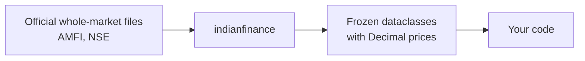

# indianfinance

A Python library for Indian market end-of-day (EOD) data from official sources.

!!! warning "Rewrite in progress"

    Version 0.1.0 is not released yet. The data functions listed below arrive in later
    0.1.0 milestones. Release 0.0.2 on PyPI is the old API, which 0.1.0 removes.

## What it will do (0.1.0)

- Mutual fund NAVs from AMFI: latest NAVs, NAV history, scheme list.
- NSE bhavcopy: end-of-day prices for stocks and ETFs, for one day or a date range.
- Returns: XIRR, CAGR, absolute and rolling returns, fixed deposit value.

## How it works

## Design rules

- **Stateless:** no database, no cache, no files written unless you ask.
- **End-of-day data only**, from official sources only.
- **`Decimal`** for prices, NAVs and money.

## Next steps

- [Install](install.md) the package.
- Browse the [API reference](reference/index.md).
- Read the [design](explanation/design.md) behind the library.
- Read the [Changelog](changelog.md).
